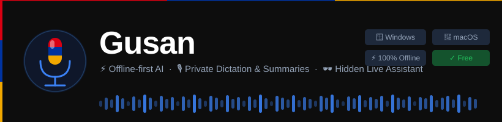

<div align="center">



<br/>

[](https://github.com/Aram2K/Gusan/releases/latest)
[](https://github.com/Aram2K/Gusan/releases/latest)
[](LICENSE)

### Press a key. Speak. Your words appear, wherever your cursor is.

Dictation, Smart Actions, meeting notes and a Live Assistant that stays out of your screen share on Windows.<br/>
Speech is turned into text on your computer by default.

**[⬇ Download for Windows](https://github.com/Aram2K/Gusan/releases/latest/download/TranscribeApp-Windows-Setup.exe)** &nbsp;·&nbsp;
**[⬇ Download for macOS](https://github.com/Aram2K/Gusan/releases/latest/download/TranscribeApp-Mac.dmg)** &nbsp;·&nbsp;
[Website](https://gusan.aibuben.xyz) &nbsp;·&nbsp; [All releases](https://github.com/Aram2K/Gusan/releases)

<sub>Prefer a portable build? Get the [Windows .zip](https://github.com/Aram2K/Gusan/releases/latest/download/TranscribeApp-Windows.zip).</sub>

</div>

---

> **Gusan was called Transcribe until version 2.0.0.** Same app, new name: your settings, history and sign-in carry over. The download files (`TranscribeApp-…`) and the data folder (`%APPDATA%\Transcribe`) keep the old name on purpose, so installed copies keep updating.

## What it does

| | |
|---|---|
| 🎙 **Dictation** `Alt+R` | Press, speak, press Enter: your words land at the cursor, in any app. Filler words like "um" are removed (you can turn that off). Works in 99 languages (Whisper), detected automatically. |
| ✍️ **Smart Actions** `Alt+S` · Pro | Say what you want ("email Anna: the demo moves to Thursday") and get the finished text with real formatting. Five free tries with a free account, written by a local AI model or your own key; Pro uses Gusan Cloud. |
| 🎧 **Meetings** · Pro | Records both sides of a call on Windows (your microphone on a Mac), labels who spoke and writes notes with action items. Export to Word, Markdown or Notion. |
| 🕶 **Live Assistant** `Ctrl+Alt+A` · Pro | A private copilot over your calls: live transcript, answers the moment you're asked something, aware of your screen. On a Mac it hears your microphone only. |
| 📄 **Audio to text** | Drop an audio or video file of any length. Get a transcript with speakers and timestamps, and a Word file if you want one. |

Also: mixed languages in one sentence · a dictionary for names and terms · your recent dictations, meetings and files on the Home page · a tray icon · start at login. (On a Mac, `Alt` is `Option`.)

## Private by default

- Whisper runs **on your computer**. Models download once (speaker labels need one more small one); after that dictation and Audio to text work offline.
- The cloud is your choice: Gusan Cloud (Pro) or your own Google Gemini or Mistral key. Only then does audio leave your computer. On Pro, Smart Actions, meeting notes and Live Assistant answers are written in Gusan Cloud, as text, unless you pick a local AI model or turn on Privacy mode.
- **Privacy mode** turns Gusan Cloud and your own keys off, so your audio and words stay on this computer.
- History, meetings and transcripts are saved on your computer, in `%APPDATA%\Transcribe` (on a Mac `~/Library/Application Support/Transcribe`). API keys go in the system keyring.
- The Live Assistant card is hidden from screen sharing on Windows 10 (2004 and later) and Windows 11, but not in Remote Desktop. On a Mac, macOS can't promise it. The chip always shows the real state: **Hidden**, **May be hidden** or **Visible**.
- Usage statistics are anonymous and can be turned off in **Settings › Privacy**.

## Free and Pro

**Free:** unlimited dictation and Audio to text on your computer, history, your own Google or Mistral key for cloud speech, five Smart Actions.
**Pro:** Meetings, Live Assistant, unlimited Smart Actions (fair use) and Gusan Cloud. See [pricing](https://gusan.aibuben.xyz/#pricing).

## Install

### Windows 10 / 11 (64-bit)

1. Download and run **[TranscribeApp-Windows-Setup.exe](https://github.com/Aram2K/Gusan/releases/latest/download/TranscribeApp-Windows-Setup.exe)**. If Windows says "Windows protected your PC" (the app isn't code-signed), click **More info → Run anyway**.
2. The first time Gusan opens, the welcome window checks your computer, recommends a speech model and sets up your microphone and shortcut.

### macOS (Apple Silicon)

1. Download **[TranscribeApp-Mac.dmg](https://github.com/Aram2K/Gusan/releases/latest/download/TranscribeApp-Mac.dmg)**, open it and drag the app (it's still named TranscribeApp) to Applications.
2. macOS blocks the first launch because the app isn't notarized. Open **System Settings → Privacy & Security → Open Anyway**, or run `xattr -dr com.apple.quarantine /Applications/TranscribeApp.app`.
3. Gusan lives in the **menu bar**. It needs three permissions under **Privacy & Security**: **Microphone**, **Accessibility** (to paste) and **Input Monitoring** (for the shortcut). A short guide opens on first launch.

On a Mac, Meetings and the Live Assistant record your microphone. Recording the other side of a call works on Windows only for now.

Gusan checks for updates and shows one quiet notice. Click it, or use **Settings › Updates & about**.

## Speech models

Gusan lists models by their real names and recommends one for your computer during setup.

| Name | Model | Download |
|---|---|---|
| Lightest | Whisper Tiny | 75 MB |
| Fast | Whisper Base | 140 MB |
| Balanced | Whisper Small | 460 MB |
| Accurate | Whisper Medium | 1.4 GB |
| Most accurate | Whisper Large v3 Turbo | 1.6 GB |
| Maximum | Whisper Large v3 | 3 GB |

Smart Actions, meeting notes and the Live Assistant can also run on a local AI model (Qwen, Gemma) instead of the cloud. On a PC with an NVIDIA graphics card, an optional download makes transcription much faster.

## Run from source

Needs Python 3.11 to 3.13, Windows 10/11 or macOS, and a microphone. On a Mac, first run `xcode-select --install` and `brew install portaudio`.

```bash
git clone https://github.com/Aram2K/Gusan.git
cd Gusan
```

```powershell
# Windows
powershell -ExecutionPolicy Bypass -File setup.ps1
run.bat
```

```bash
# macOS
bash setup_mac.sh
bash run.sh
```

To run the tests, `pip install pytest` in the venv, then `python -m pytest -q tests` and, separately, `python -m pytest -q tests_qt` (a few minutes).

## Build and release

```powershell
powershell -ExecutionPolicy Bypass -File build.ps1   # dist\TranscribeApp\TranscribeApp.exe
```

Releases are built by GitHub Actions when a version tag is pushed. The steps, and the names that must never change, are in [RELEASING.md](RELEASING.md). Release notes live in [`docs/release-notes`](docs/release-notes).

| Folder | What's in it |
|---|---|
| `ui/` | The window, its pages and the floating cards |
| `supabase/` | The cloud functions: sign-in, billing, Gusan Cloud, Smart Actions, Notion connect, feedback and anonymous statistics |
| `installer/` | The Windows installer |
| `tests/`, `tests_qt/` | Unit tests and screen tests |

## License

Free for personal, educational and non-commercial use. You may modify and share it with attribution; you may not sell it or use it in a paid product or service. See [LICENSE](LICENSE). For a commercial license, write to **aramatamian15@gmail.com**.

## Author

Made by **[Aram Adamyan](https://www.linkedin.com/in/aram-adamyan-2k/)**, founder of [Aibuben.xyz](https://aibuben.xyz).
[Website](https://gusan.aibuben.xyz) · [LinkedIn](https://www.linkedin.com/in/aram-adamyan-2k/) · [GitHub](https://github.com/Aram2K) · [Report an issue](https://github.com/Aram2K/Gusan/issues)

<div align="center">
<sub>Made with ❤️ for anyone who types too slowly.</sub>
</div>
