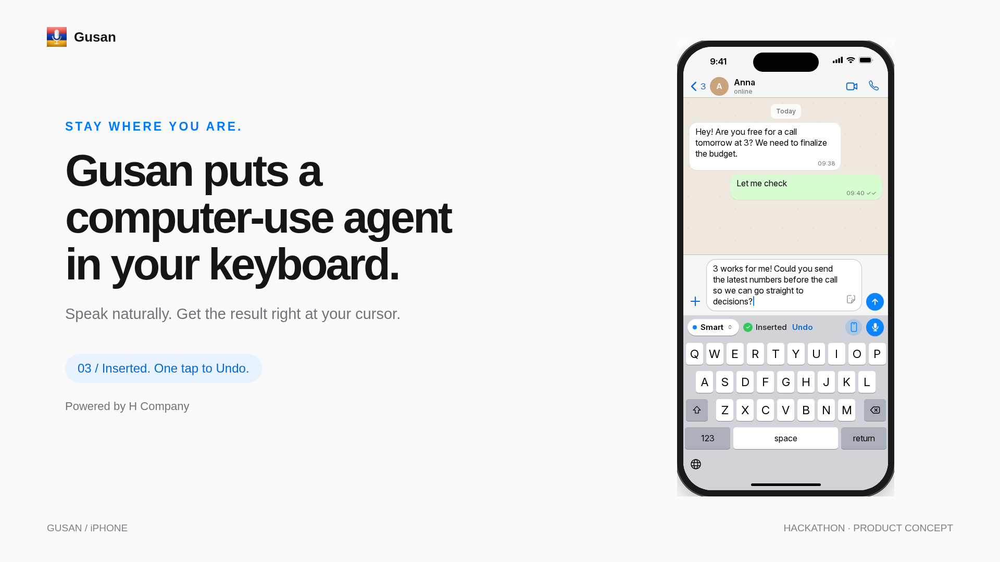

### Gusan: the iPhone keyboard that does things for you

Say what you want, wherever you're typing. Gusan writes it for you, or an H Company computer-use agent goes and does it.

**[⬇ Download the iPhone app (.ipa)](https://github.com/Aram2K/Gusan/releases/download/ios-hackathon/Gusan-iOS.ipa)** &nbsp;·&nbsp;
[How to test](docs/ios/hackathon/HOW_TO_TEST.md) &nbsp;·&nbsp;
[Intro video](docs/ios/hackathon/video/intro.mp4) &nbsp;·&nbsp;
[Product description](docs/ios/hackathon/PRODUCT_DESCRIPTION.md)

---

## What it is
Gusan is an iPhone keyboard with a slim strip above the normal keys. Tap the mic and talk. It has two modes:
- **Smart:** uses your selected text, the text around the cursor, your calendar's busy times and, if you allow it, your screen. It writes the reply, translation or answer straight into the field you're typing in, with one-tap Undo.
- **Agent:** hands your request to an H Company computer-use agent, which works in a real browser. You follow its progress in the Dynamic Island. Nothing irreversible happens without your **Confirm**, and you can Stop it at any time. Logins come from a Face ID-protected Vault, and the agent never sees your password.

Example: *"find the best deal on an iPhone 15 Pro on Leboncoin"* returns 3 real listing links with prices and condition, and a recommendation.

## Try it
See **[How to test](docs/ios/hackathon/HOW_TO_TEST.md)**: install with Sideloadly or AltStore (no TestFlight yet), or test it on our phone at the event.

## Stack
H Company computer-use agents (planning, execution, Vault) · Gladia speech-to-text · Linkup web search · Devin LLM for Smart · Supabase (Auth, Postgres, Edge Functions) · Stripe · Swift/SwiftUI app, custom keyboard extension, ActivityKit Live Activities, EventKit

## Where things are
| Path | What |
|---|---|
| [`ios/`](ios/) | iPhone app, keyboard extension, Live Activity widget, shared `GusanKit` package |
| [`supabase/functions/`](supabase/functions/) | `agent-action` (H agent state machine), `agent-vault`, `smart-action` |
| [`docs/ios/design/v4/`](docs/ios/design/v4/) | Final design mockups |
| [`docs/ios/spec/`](docs/ios/spec/) | Technical spec and security review |
| [`docs/ios/hackathon/`](docs/ios/hackathon/) | Product description, demo plan, videos, test reports |

Gusan also has a Windows/macOS desktop app; see [DESKTOP_README.md](DESKTOP_README.md).
